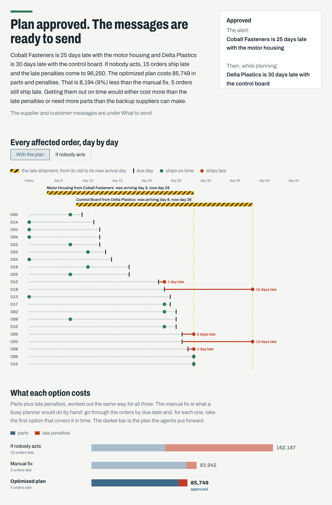
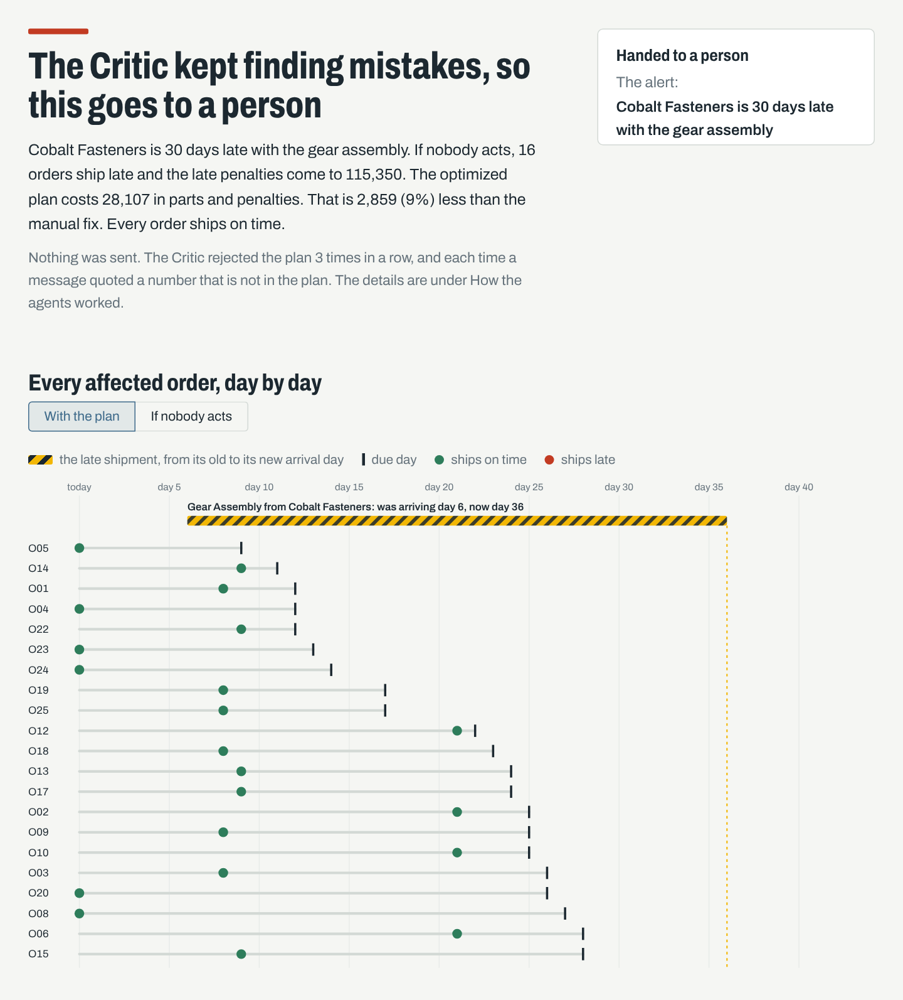

# Disruption Replanner

When a supplier tells a factory that a shipment will be late, someone has to work out which customer orders
are now at risk, find the cheapest way to recover, and tell the right suppliers and customers. This project
does that with four cooperating agents built on LangGraph, and a Streamlit app where a person reviews the plan
and approves or rejects it before anything is sent.

Everything runs on a small made-up plant: 4 suppliers, 8 parts, 3 products and 25 customer orders.

## How it works

A delay comes in as a short alert, for example "S2 delays P4 by 25 days". Four agents then take turns:

1. **Planner** reads the alert and checks it against the supplier list. It rejects alerts that name an
   unknown supplier or part, a supplier that does not sell that part, or a delay outside 1 to 60 days.
2. **Impact Analyst** finds every open order that needs the late part, hands out the stock on the shelf by due
   date, and works out which orders will now ship late and what the late penalties would be if nobody acts.
3. **Replanner** builds the cheapest plan with a small optimization model (PuLP). For each order it can use
   stock, wait for the late shipment, pay the late supplier to rush part of it, or buy from a backup supplier.
   It also drafts a message to each supplier involved and to each customer whose order will still be late.
4. **Critic** throws away the Replanner's own numbers, works everything out again from the raw tables, and
   checks five things before the plan reaches a person:

   | Check | What it means |
   |---|---|
   | R1 | Never uses more stock than is on the shelf |
   | R2 | Never asks a supplier for more than they can make |
   | R3 | Every affected order gets all the parts it needs |
   | R4 | The reported cost matches a fresh recalculation |
   | R5 | Every number in every message matches the plan |

The person then approves or rejects. Nothing is sent before that.

### When things go wrong

| Situation | What happens |
|---|---|
| The Critic finds a problem with the plan | The Replanner solves again once. If it still fails, it switches to the manual fix |
| The Critic finds a problem only in the messages | The plan is kept and only the messages are rewritten |
| The person rejects the optimized plan | They are offered the manual fix instead |
| The person rejects the manual fix too | The case goes to a person, since there is no other plan to offer |
| The Critic still finds problems after two retries | The case goes to a person, with the full agent log |
| A second delay arrives during planning | It is folded in, and the work restarts at the Impact Analyst with both delays |
| The second alert cannot be used | It is ignored and noted in the log, and planning carries on |
| The first alert needs no action but a second one does | The second alert is still planned for |

The **manual fix** is the comparison point used throughout: what a busy planner would do by hand. It goes
through the orders by due date and, for each one, takes the first option that covers it in time, without
splitting an order across sources.

## What the numbers say

These come from the 20 test cases in `scenarios/scenarios.json`. The app works them out again every time it
starts, so they always match the current code and data.

- **20 of 20** test cases end the way they should.
- **12** of them need a new plan. The optimized plan is cheaper than the manual fix in **all 12**.
- The typical (median) saving is **19%**, ranging from 5% to 80%.
- The two cases above half are long delays (plastic casing at 45 days, sensor module at 60 days) where the
  manual fix ends up waiting for the late shipment and paying heavy penalties. They pull the average up, which
  is why the median is the fair number to quote.
- Late orders across the 12 cases: **21** with the optimized plan and **22** with the manual fix. In two cases
  (the control board delay, and two delays hitting the same orders) the optimized plan lets more orders run
  late than the manual fix, because paying those penalties costs less than rushing or buying elsewhere. The
  total cost is still lower in both.
- Both planted mistakes are caught by the Critic. A wrong total is fixed on the retry, and messages that always
  quote the wrong quantity end with the case going to a person.

The two planted-mistake cases are left out of the cost figures. They test the Critic, and one of them repeats
an ordinary case, so including them would count that case twice.

## Assumptions in the model

These keep the model small. They are all set in `config.py` or in the data files.

- Each part has one main supplier, and that is the only supplier with a shipment on its way. Backup suppliers
  have nothing in transit, so a delay from a backup only matters if the plan buys from them, in which case
  their parts arrive later by the same number of days.
- The late shipment holds exactly the units that stock cannot cover.
- Day 0 is today. A normal shipment arrives after the supplier's lead time, a late one after lead time plus
  the delay.
- Rushing the late supplier costs 35% more per unit, halves the delay, and can cover at most half of that
  supplier's capacity.
- Buying from a backup supplier costs 10% more per unit and is limited by their capacity.
- An order ships when its last missing part arrives. Each day late costs that order's penalty per day.
- Money has no currency attached. All amounts are in the same made-up unit.

## Setup

Python 3.10 or newer.

    python -m venv .venv
    source .venv/bin/activate          # Windows: .venv\Scripts\activate
    pip install -r requirements.txt

`pulp` is pinned to 2.9.0, the version the project is tested with. PuLP has had major releases since then, so
keep the pin unless you retest.

## Running it

    streamlit run app.py

In the app, pick the late supplier, the part and how many days late it is, then press **Plan the recovery**.
There are also three ready-made examples under the button, and every test case can be run from the bottom of
the page. A **Testing** menu next to the button plants a deliberate mistake, to show the Critic catching it.

The app loads the Archivo font from Google Fonts. Without an internet connection it falls back to a standard
font and still works.

Other entry points:

    python data/generate_data.py                          # rebuild the 4 CSV files in data/ (same seed, same data)
    python run_tools_demo.py "S2 delays P4 by 10 days"    # one or two alerts through the tools, no agents
    python run_agents_demo.py "S2 delays P4 by 20 days" --late "S1 delays P1 by 35 days"
    python scenarios/make_scenarios.py                    # rewrite scenarios.json
    python run_scenarios.py --mode tools                  # all 20 test cases through the tools only
    python run_scenarios.py --mode graph                  # all 20 through the agents, planted mistakes on

The alert parser accepts the supplier, part and delay in any order, and understands weeks
("S2 delays P4 by 2 weeks"). It refuses fractions of a day and negative delays rather than guessing.

## Tests

    python test_tools.py && python test_agents.py && python test_app.py

`test_tools.py` checks each tool and plants errors for the Critic to catch. `test_agents.py` walks the agents
through every path in the table above. `test_app.py` clicks through the app without a browser.

## Project layout

    config.py              prices, limits and the allowed delay range, in one place
    data/                  suppliers, bill of materials, stock and orders as CSV, plus the script that makes them
    tools/alerts.py        Planner: read and check an alert
    tools/impact.py        Impact Analyst: affected orders, stock, shortfall
    tools/replanner.py     Replanner: optimized plan, manual fix, messages
    tools/critic.py        Critic: recalculate the cost and run the five checks
    tools/pipeline.py      the whole flow as one plain function, without agents
    agents/                one file per agent, the shared state, planted mistakes, and the LangGraph wiring
    app.py, app_logic.py   the Streamlit app, and the logic behind it (testable without Streamlit)
    .streamlit/config.toml colours and font
    scenarios/             the 20 test cases and their results
    run_*.py, test_*.py    demos, the test-case runner, and the tests
    docs/                  screenshots

## Limits

- The data is synthetic and small. The point is the workflow, not a real plant.
- Alerts are read with simple rules, not a language model. They must name a supplier like S2, a part like P4,
  and a number of days or weeks.
- Messages are filled-in templates. An LLM could write them, and the Critic's R5 check is there so that a
  model could not slip a wrong number past the person.
